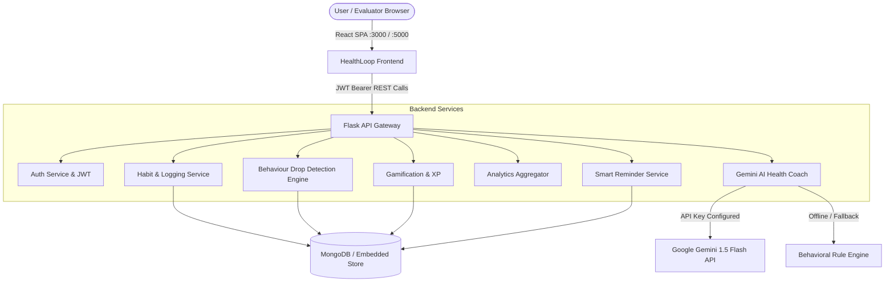

# HealthLoop Technical Architecture & System Design

## 1. System Overview

HealthLoop is designed around a decoupled, modular service-oriented architecture:
- **Client Presentation Layer**: React 19 Single Page Application (SPA) powered by Tailwind CSS, Chart.js, and Lucide icons.
- **RESTful API Gateway & Service Layer**: Python Flask application structured with Blueprints and specialized domain services.
- **Data Persistence Layer**: MongoDB collections with document validation, indexed queries, and transparent embedded fallback store.
- **Cognitive Layer**: Google Gemini 1.5 Flash API with prompt safety filters and a deterministic behavioral fallback engine.

---

## 2. Database Design & The 10 MongoDB Collections

The system strictly implements the 10 collections requested in the database specification:

1. **`users`**:
   - `_id`: String (UUID)
   - `username`: String
   - `email`: String (Unique index)
   - `password_hash`: String (BCrypt)
   - `role`: String (`user` or `guest`)
   - `is_guest`: Boolean
   - `created_at`: ISO 8601 Timestamp

2. **`user_profiles`**:
   - `user_id`: Reference to `users._id`
   - `display_name`: String
   - `avatar_url`: String
   - `bio`: String
   - `age`, `gender`, `height_cm`, `weight_kg`: Biometrics
   - `daily_water_target_ml`: Integer (e.g. 2500)
   - `daily_sleep_target_hours`: Float (e.g. 8.0)
   - `daily_exercise_target_mins`: Integer (e.g. 45)
   - `points`: Integer (XP)
   - `level`: String (e.g. "Gold Explorer")
   - `ai_consent`: Boolean
   - `unlocked_badges`: Array of `{ code, unlocked_at }`

3. **`habits`**:
   - `_id`: String
   - `user_id`: Reference to `users._id`
   - `title`: String
   - `category`: Enum (`water`, `exercise`, `sleep`, `mindfulness`, `nutrition`, `screen_time`, `custom`)
   - `target_value`: Numeric
   - `unit`: String (`ml`, `steps`, `hours`, `mins`, `meals`)
   - `icon`: Lucide icon name
   - `color`: Hex color
   - `reminder_time`: HH:MM string
   - `streak`: Current consecutive active days
   - `best_streak`: Longest achieved streak
   - `is_active`: Boolean

4. **`habit_logs`**:
   - `_id`: String
   - `user_id`: Reference
   - `habit_id`: Reference
   - `date`: YYYY-MM-DD
   - `target_value`: Numeric
   - `achieved_value`: Numeric
   - `completed`: Boolean
   - `notes`: String
   - `created_at`: ISO 8601 Timestamp

5. **`daily_goals`**:
   - `user_id`: Reference
   - `date`: YYYY-MM-DD
   - `health_score`: Calculated 0-100 composite score
   - `target_habits_count`: Integer
   - `completed_habits_count`: Integer
   - `status`: String

6. **`reminders`**:
   - `_id`: String
   - `user_id`: Reference
   - `habit_id`: Reference (optional)
   - `title`: String
   - `category`: String
   - `scheduled_time`: HH:MM string
   - `days_of_week`: Array [1..7]
   - `enabled`: Boolean

7. **`achievements`**:
   - `_id`: String
   - `code`: Unique badge code (`FIRST_STEP`, `SEVEN_DAY_STREAK`, `WATER_CHAMPION`, `SLEEP_MASTER`, `FITNESS_EXPLORER`, `CONSISTENCY_CHAMPION`, `COMEBACK_HERO`)
   - `title`, `description`, `badge_icon`, `category`, `points`

8. **`challenges`**:
   - `_id` / `id`: String
   - `title`: String
   - `description`: String
   - `category`: String
   - `duration_days`: Integer (7, 21, 30)
   - `xp_reward`: Integer
   - `participants_count`: Integer

9. **`challenge_participants`**:
   - `challenge_id`: Reference
   - `user_id`: Reference
   - `progress_days`: Integer
   - `target_days`: Integer
   - `completed`: Boolean
   - `joined_at`: Timestamp

10. **`ai_recommendations`**:
    - `user_id`: Reference
    - `type`: `chat_response`, `daily_suggestion`, `drop_recovery`, `weekly_summary`
    - `user_query`: String
    - `response`: Text

---

## 3. Behaviour Drop Detection Algorithm

The behaviour drop detection engine operates on an event-driven analysis:
1. **Window Evaluation**: Scans the last 10 days of user logs for each active habit.
2. **Consecutive Miss Detection**: Detects $\ge 2$ consecutive missed days immediately preceding today.
3. **Prior Consistency Verification**: Checks if user had an established momentum of $\ge 2$ completions prior to the break.
4. **Severity & Micro-Plan Computation**:
   $$\text{Recovery Target} = \max\left(1, \lfloor \text{Original Target} \times 0.4 \rfloor\right)$$
   For instance, a 45-minute workout habit scales back to a 15-minute gentle stretch or walk.
5. **Empathy & Reason Gathering**: Prompts the user with an empowering check-in without punitive streak cancellation.
6. **Resumption Tracking**: Automatically detects when the next log is registered, changes drop status to `resumed`, awards +100 XP, and unlocks the **"Comeback Hero"** achievement.
